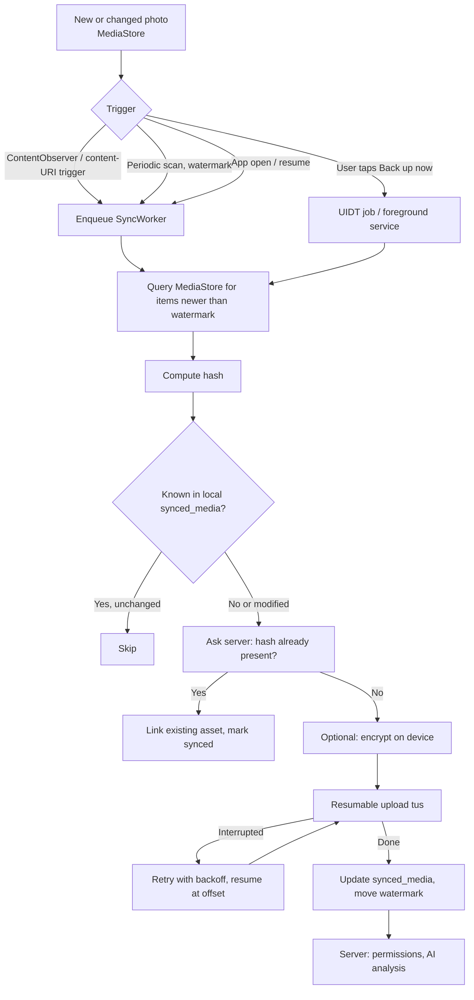

# AirPx Android App: Research (Issue #7)

Research on Android technologies, automatic photo synchronization and permissions.
Status: October 2026. Platform rules change often, so re-check the **Verify** column items before implementation.

**How to read this document:** items marked *(verified)* were checked against current Android/Play documentation or other sources during this research. Items marked *(from experience, not re-verified)* are common practice that was not checked online and should be confirmed in the proof of concept.

---

## 1. Summary of recommendations

| Topic | Recommendation |
|---|---|
| Language / UI | Kotlin + Jetpack Compose |
| Platform strategy | Native Android first. Keep domain and data layers free of Android types so they can be moved to Kotlin Multiplatform later |
| Target SDK | **36** (mandatory for new apps and updates on Google Play since Aug 31, 2026) *(verified)* |
| Min SDK | **29** (Android 10, scoped storage). 30 is also reasonable. Team decision |
| Background sync | WorkManager (constraints) + ContentObserver/content-URI trigger + periodic MediaStore scan as fallback |
| Initial big upload | User-initiated data transfer job (Android 14+), foreground service fallback for older versions |
| Uploads | Resumable uploads (tus protocol) with SHA-256 based duplicate check |
| Media permission | `READ_MEDIA_IMAGES` + `READ_MEDIA_VISUAL_USER_SELECTED`, plus Play Console declaration as backup app |
| Push | FCM by default, optional UnifiedPush for self-hosted setups, behind one interface |
| QR codes | Google code scanner (no camera permission) with ZXing/bundled ML Kit as fallback |
| Secret storage | DataStore + Tink (not EncryptedSharedPreferences, it is deprecated) |

---

## 2. Android technologies

### 2.1 Language, UI and platform strategy

- **Kotlin + Jetpack Compose** is the recommended toolkit for new Android UI. Kotlin 2.4.x is current *(verified, secondary sources)*.
- **Kotlin Multiplatform (KMP)** has been stable since Kotlin 1.9.20 (Nov 2023). Compose Multiplatform for iOS has been stable since 1.8.0 (May 2025) *(verified, secondary sources)*.
- The repo's `iosApp/Readme.md` only mentions **xtool** (Swift/iOS builds without a Mac), which suggests iOS is planned as a separate Swift app. Sharing code via KMP would be a bigger decision than this issue.
- **Recommendation:** build the Android app natively with Compose. Structure it in layers (`domain`, `data`, `ui`) and prefer KMP-capable libraries where there is no downside, so a later KMP move stays cheap.

### 2.2 Libraries

*(All rows in this table are from experience, not re-verified, except where noted.)*

| Area | Choice | Notes |
|---|---|---|
| Architecture | MVVM, ViewModel + StateFlow, Navigation Compose | Standard Google guidance |
| DI | Hilt (or Koin if KMP is likely) | Hilt is Android-only |
| Networking | Retrofit + OkHttp, or Ktor | Ktor if KMP later, otherwise Retrofit/OkHttp is the safer default |
| Local DB | Room | Metadata, sync state, offline index |
| Image loading | Coil | Compose-first |
| Camera | System camera intent first, CameraX only for an in-app camera | The intent needs no `CAMERA` permission |
| Serialization | kotlinx.serialization | |

### 2.3 QR codes

- The **Google code scanner** (`play-services-code-scanner`) scans codes **without the app requesting the camera permission**. It returns only the result to the app and requires API level 21+ *(verified)*.
- It is an *unbundled* module delivered through Google Play services. Users without Play services (de-Googled phones, F-Droid users, which fits the self-hosting audience) cannot use it.
- **Recommendation:** use the code scanner as the default and fall back to a bundled scanner (ML Kit bundled model or ZXing) with `CAMERA` permission when Play services are missing.

### 2.4 Push notifications

- **FCM** is the default on Android. Even with minimal payloads, it routes wake-up metadata through Google *(verified)*.
- **UnifiedPush** is an open standard. A *distributor* app (e.g. ntfy) keeps one connection and forwards messages to apps. It only **delivers data**; the app must build the visible notification itself. A push gateway may be needed if the server does not speak UnifiedPush natively *(verified)*.
- **Recommendation:** define a `PushProvider` interface in the app. Implement FCM first. Add UnifiedPush later for self-hosted installs, since the project explicitly lists "selfhosted" as a feature. The backend needs a matching abstraction.

### 2.5 Secure storage of tokens and keys

- `EncryptedSharedPreferences` / `androidx.security:security-crypto` is **deprecated** (since 1.1.0-alpha07, no further releases planned) *(verified)*.
- Recommended replacement: **Jetpack DataStore + Tink** (`androidx.datastore:datastore-tink`, available from 1.3.0-alpha07 per OWASP MASTG) with the master key in Android Keystore *(verified)*.
- Note: the checklist in Issue #7 originally mentioned EncryptedSharedPreferences. Please treat that as outdated.

### 2.6 SDK levels

- **Target SDK:** new apps and app updates must target **Android 16 (API 36)** from **Aug 31, 2026**. Existing apps must target at least API 35 to stay visible to new users on newer devices *(verified, developer.android.com)*. Expect this to rise yearly.
- **Min SDK:** worldwide Android version share in July 2026 (StatCounter): Android 16 about 25.5%, 15 about 17.2%, 13 about 14.8%, 14 about 13.1%, 12 about 10.1%, 11 about 8.3%. Android 11 and newer therefore covers roughly 89% *(verified, one statistics source; regional numbers differ)*.
- Min SDK 29 avoids the legacy storage code paths (`READ/WRITE_EXTERNAL_STORAGE` semantics) and gives `ACCESS_MEDIA_LOCATION` and `RELATIVE_PATH`. Immich (a comparable open-source photo backup app) supports Android 8+, but pays for it in complexity *(verified)*.

---

## 3. Photo synchronization

### 3.1 What comparable apps teach us

- **Immich** uploads new photos from selected albums when the app opens or resumes **and** periodically in the background. It computes a **content checksum** per file to skip assets already on the server, and it notes that strict battery optimization on some Android models breaks the background worker *(verified)*. Its Android manifest uses a `dataSync` foreground service and `MANAGE_MEDIA` *(verified, F-Droid listing)*.
- **Nextcloud** auto-upload has many user reports of uploads stopping when the app is not visible, uploads that "jam" for a folder, slow one-by-one uploads and long scans of large folders *(verified, GitHub issues and forum threads, anecdotal)*. These are the failure modes to design against.

### 3.2 Detecting new and changed photos

Use two layers; neither alone is enough:

1. **Instant layer:** `ContentObserver` on `MediaStore.Images.Media.EXTERNAL_CONTENT_URI`, or a WorkManager work request with a content-URI trigger (JobScheduler supports `TriggerContentUri` since Android 7) *(verified)*. A `ContentObserver` only fires while the process is alive.
2. **Reliable layer:** periodic WorkManager scan that queries MediaStore for items newer than a stored watermark (`DATE_ADDED`, and `DATE_MODIFIED` / `GENERATION_MODIFIED` for edits) *(verified for the pattern, field names from experience)*.

Keep a local Room table, e.g. `synced_media(mediaStoreId, contentHash, serverId, dateModified, state)`.

### 3.3 Running syncs in the background

| Mechanism | Use for | Limits |
|---|---|---|
| WorkManager periodic/one-time work | Normal incremental sync. Constraints: unmetered network, charging, battery not low | Runs subject to Doze, App Standby and quota; timing is not exact. Per-worker max execution time |
| WorkManager expedited work | Short, time-sensitive syncs | Quota based on standby bucket; falls back to normal work if exhausted |
| **User-initiated data transfer (UIDT) job** | First full backup the user explicitly starts | Android 14+, needs `RUN_USER_INITIATED_JOBS`, must be scheduled while the app is visible, shows a notification, user can stop it; **not affected by App Standby bucket quotas** |
| `dataSync` foreground service | Fallback on Android 13 and below | On targetSdk 35+: **6 hours per 24 hours**, then `onTimeout()` is called; start only from direct user interaction |

*(All verified against developer.android.com.)*

**Recommendation:** WorkManager for ongoing sync. Offer an explicit "Back up now / initial backup" action that runs as a UIDT job on Android 14+ and as a foreground service below. Make every step idempotent so interrupted runs resume safely.

### 3.4 Doze, App Standby and manufacturer restrictions

- Doze and standby buckets delay or stop WorkManager jobs *(verified)*.
- On top of that, several manufacturers (notably Xiaomi, Huawei, OnePlus, Oppo/Vivo and, more moderately, Samsung) add their own background killers, sometimes even stopping foreground services *(verified, dontkillmyapp.com and secondary sources)*.
- **Mitigation:** show a sync status screen with "last successful sync", detect `Build.MANUFACTURER` and link to per-vendor instructions or dontkillmyapp.com, and always sync on app open/resume as a catch-up. Do not rely on background sync alone.
- Requesting `REQUEST_IGNORE_BATTERY_OPTIMIZATIONS` is restricted by Google Play policy. *(from experience, not re-verified; check before use)*

### 3.5 Efficient uploads

- Use the **tus** resumable upload protocol: an interrupted upload resumes from the server's known offset instead of restarting *(verified)*. Clients: `tus-android-client` (builds on `tus-java-client`) and `Ktus` (Kotlin, Ktor-based, third-party) *(verified)*. Server side: `tusd` or compatible. This must be agreed with the backend team.
- Alternative if tus is too heavy: own chunked-upload API (init, upload chunk with offset, complete).
- Add retry with exponential backoff (WorkManager `BackoffPolicy`), upload progress notification, and sequential or low-parallelism uploads (Nextcloud reports show one-by-one uploads are slow, so test parallelism of 2 to 3).

### 3.6 Duplicate prevention

- Compute a **content hash** (SHA-256) per file before upload and ask the server whether it already has it (Immich does this with a checksum) *(verified)*.
- Local `synced_media` table prevents re-uploading when MediaStore fires twice for the same file.
- If the server runs AI duplicate detection, the client hash handles exact duplicates and the server handles near-duplicates.

### 3.7 Syncing edited photos

- Detect edits via `DATE_MODIFIED` / generation values plus a changed hash *(from experience, not re-verified)*.
- Proposal: never overwrite on the server. Upload as a **new version** of the asset and keep the original; the user can restore. This avoids data loss on conflicts (edit on phone and in web at the same time).
- Conflict policy to decide: last-writer-wins vs. keep both.

### 3.8 End-to-end encryption: important interaction

- Encrypting on the device before upload means the server **cannot** run its AI features (OCR, face recognition, search, dedup) on the plaintext. The deployment diagram has these on the server side.
- Options: (a) E2EE only for private albums and AI features only for non-E2EE content; (b) run AI on-device for E2EE content; (c) per-user opt-in for server-side processing.
- Duplicate checks with E2EE need a **keyed hash** (e.g. HMAC with a user-derived key), otherwise plain hashes leak whether a user owns a known file. *(This is a design proposal, not verified.)*
- This is the largest open design question and should be decided together with the backend team.

### 3.9 Folder selection and album mapping

- Let the user choose which device folders/buckets to back up (default: camera folder, typically `DCIM/Camera`). Immich offers the same album selection and can mirror device albums as server albums *(verified)*.
- Map device buckets to a top-level AirPx album per folder, then let the user move items into the nested album tree on the server. Do not try to mirror nested permissions from the device.

### 3.10 Proposed sync flow

---

## 4. Permissions

| Permission | Android version | Purpose | If denied |
|---|---|---|---|
| `READ_MEDIA_IMAGES` | 13+ (API 33+) | Read all photos for auto-backup | Fall back to partial access or manual photo picker uploads |
| `READ_MEDIA_VISUAL_USER_SELECTED` | 14+ (API 34+) | User grants access to **selected** photos only | App works only on selected items; show "limited access" banner and a way to select more |
| `READ_EXTERNAL_STORAGE` | up to 12 (API ≤ 32) | Read photos on older versions | Same as above |
| `ACCESS_MEDIA_LOCATION` | 10+ (API 29+) | Read GPS from EXIF (sort by location). Also requires `MediaStore.setRequireOriginal()`, otherwise EXIF location is redacted | Location sorting unavailable for those photos; everything else works |
| `POST_NOTIFICATIONS` | 13+ (API 33+) | Shared albums, friend requests, comments, upload progress | No notifications; show in-app inbox instead. Foreground-service/UIDT notifications still work in the task manager |
| `CAMERA` | all | Only for an in-app camera or fallback QR scanner | Use system camera intent; use Google code scanner |
| `INTERNET`, `ACCESS_NETWORK_STATE` | all | Network and sync constraints | n/a (install-time, normal permissions) |
| `FOREGROUND_SERVICE` + `FOREGROUND_SERVICE_DATA_SYNC` | 14+ for the type permission | Fallback for long uploads below Android 14 | Rely on WorkManager only |
| `RUN_USER_INITIATED_JOBS` | 14+ (API 34+) | Long, user-started initial backup | Fall back to foreground service / WorkManager |
| `MANAGE_MEDIA` (optional) | 12+ | Modify/replace edited local photos without a prompt each time (Immich declares it) | System confirmation dialog per edit/delete |

*Rows for `READ_MEDIA_*`, `READ_MEDIA_VISUAL_USER_SELECTED`, `ACCESS_MEDIA_LOCATION`, `RUN_USER_INITIATED_JOBS` and the dataSync service are verified. `POST_NOTIFICATIONS`, `CAMERA`, `INTERNET` and `MANAGE_MEDIA` details are from experience and the Immich manifest; re-check in the PoC.*

### 4.1 Partial photo access (Android 14+)

- Users can grant access to selected photos only. Apps targeting 14+ must declare `READ_MEDIA_VISUAL_USER_SELECTED`, and request it together with `READ_MEDIA_IMAGES` (the system shows the choice dialog) *(verified)*.
- Auto-backup with partial access only covers what the user selected. On Android 15+ (and 14 with Play system updates) the app can query only the most recent selection (`QUERY_ARG_LATEST_SELECTION_ONLY`) *(verified)*.
- UX: detect full/partial/denied state and show the state clearly on the backup screen, with a button to change the selection.

### 4.2 Runtime permission flow (proposal)

1. Do **not** ask on first launch. Ask when the user turns on "Auto-backup" (in context, with an explanation screen first).
2. Request media permission. Handle full, partial and denied.
3. Ask for `POST_NOTIFICATIONS` after the user starts the first sync (progress notification is the justification).
4. Ask for `ACCESS_MEDIA_LOCATION` only when the user enables location-based sorting.
5. On denial: explain once, then offer "Open settings". Never block basic manual upload via the system photo picker.

### 4.3 Google Play policy

- Only apps whose **core functionality** needs broad photo access may keep `READ_MEDIA_IMAGES`/`READ_MEDIA_VIDEO`. Others must use the system photo picker. Developers must submit a **declaration form in Play Console**. Non-compliant apps can be removed *(verified, Play Console help)*.
- Gallery and photo/video manager apps are the most commonly eligible. One secondary source also lists backup and restore as an accepted use case *(verified, secondary)*. AirPx is a gallery plus backup app, so the case is strong, but approval is Google's decision.
- The policy also expects a **reasonable effort to support users who do not grant broad access** *(verified)*. Our partial-access and photo-picker fallbacks cover this.
- Also needed for release: Data safety declaration (photos, location from EXIF, account data) and a privacy policy. *(from experience, not re-verified)*
- If the app is distributed outside Google Play (self-hosted users, F-Droid), these Play rules do not apply, but the platform permissions still do.

---

## 5. Open risks and questions

1. **E2EE vs. server-side AI** (see 3.8). Needs a decision with the backend team.
2. **Background reliability on aggressive OEMs.** Cannot be fully solved. Needs in-app status, catch-up sync and user guidance.
3. **Play approval** of the broad media permission is not guaranteed. Prepare the declaration text and a demo video early. Fallback: photo-picker-only mode.
4. **Self-hosted users without Google Play services:** affects push (FCM), QR scanner (code scanner), and possibly app distribution. Decide whether to support F-Droid/APK installs.
5. **Upload protocol:** tus vs. custom chunked API. Backend must implement the server side.
6. **Edit/conflict policy** (versioning vs. last-writer-wins) and storage cost of versions.
7. **Min SDK:** 29 vs. 30 (team decision).
8. **KMP:** stay Android-only for now or share the data layer with a future iOS app.
9. **Initial backup size:** users with tens of thousands of photos. Plan a prioritization (newest first), pause/resume, and a Wi-Fi-only default. Nextcloud reports show this scenario hurts.
10. **Rules change yearly** (target API, foreground service rules, photo permissions). Plan a yearly review.

---

## 6. Suggested proof of concept

A small Android Studio project that:

1. Requests `READ_MEDIA_IMAGES` + `READ_MEDIA_VISUAL_USER_SELECTED` and shows full/partial/denied state.
2. Registers a content-URI-triggered WorkManager job plus a periodic scan with a watermark.
3. Hashes new photos, uploads them to a tus test server (`tusd`) and records them in Room.
4. Runs a test on at least one strict-OEM device (e.g. Xiaomi or Samsung) and one Pixel/emulator, with the app swiped away, to measure how reliable background sync really is.

---

## 7. Sources

- Google Play target API level requirements: developer.android.com/google/play/requirements/target-sdk and Play Console Help (answer 11926878)
- Photo and Video Permissions policy: Play Console Help (answer 14115180)
- Partial photo/video access (Android 14): developer.android.com/about/versions/14/changes/partial-photo-video-access
- Foreground service timeouts (Android 15): developer.android.com/about/versions/15/behavior-changes-15
- User-initiated data transfer jobs: developer.android.com/develop/background-work/background-tasks/uidt
- WorkManager (expedited work, constraints): developer.android.com/guide/background/persistent
- Background optimization (content URI triggers): developer.android.com/topic/performance/background-optimization
- Google code scanner: developers.google.com/ml-kit/code-scanner
- UnifiedPush: f-droid.org/2022/12/18/unifiedpush.html
- Immich mobile backup docs: docs.immich.app/features/mobile-backup
- Nextcloud Android auto-upload issues: github.com/nextcloud/android (issues #8285, #12675, #6794)
- Don't kill my app: dontkillmyapp.com
- tus protocol: tus.io, github.com/tus/tus-android-client
- EncryptedSharedPreferences deprecation: OWASP MASTG-BEST-0050 and community migration guides
- Android version share: gs.statcounter.com (July 2026)
- Photo location redaction (`ACCESS_MEDIA_LOCATION`, `setRequireOriginal`): developer.android.com MediaStore reference and community write-ups